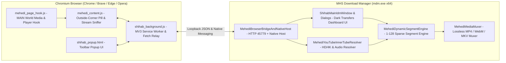

<div align="center">


# MHS Download Manager

**High-Speed Windows x64 Download Accelerator, Smart Browser Stream Sniffer & Lossless Media Muxer**

Developed by **[Mehedi Hasan Shihab](https://sshihabb007.github.io/)** (`@sshihabb007`)

[](https://github.com/sshihabb007/MHS-DOWNLOAD-MANAGER/releases/latest)
[](https://github.com/sshihabb007/MHS-DOWNLOAD-MANAGER/actions/workflows/build.yml)
[-06B6D4?style=for-the-badge&logo=windows&logoColor=white)](https://github.com/sshihabb007/MHS-DOWNLOAD-MANAGER/releases/latest)
[](#build-from-source)
[](LICENSE)

<br />

[-v1.0.5-0D74E7?style=for-the-badge&logo=windows11&logoColor=white)](https://github.com/sshihabb007/MHS-DOWNLOAD-MANAGER/releases/latest/download/MHS-Download-Manager-Setup-1.0.5-x64.exe)
[-v1.0.5-1E293B?style=for-the-badge&logo=windows&logoColor=white)](https://github.com/sshihabb007/MHS-DOWNLOAD-MANAGER/releases/latest/download/MHS-Download-Manager-Portable-1.0.5-x64.exe)

[**Installation Guide**](#installation) · [**Load Browser Extension**](#extension-setup) · [**Key Features**](#key-features) · [**Architecture**](#architecture) · [**CLI Reference**](#cli-reference) · [**Developer**](#developer)

</div>

---

## Overview

**MHS Download Manager (`mdm.exe` v1.0.5)** is a clean-room, open-source Windows x64 download accelerator and Manifest V3 Chromium browser extension suite crafted in pure C# and vanilla JavaScript by **Mehedi Hasan Shihab**.

Engineered for maximum throughput and zero bloat, the desktop application, custom lossless container muxer, and graphical Windows Setup Wizard compile directly with the built-in Windows `.NET Framework 4.8` compiler (`csc.exe`) — requiring **zero external NuGet packages, zero third-party DLLs, and no external `ffmpeg.exe` installation**.

---

<a id="installation"></a>
## 📦 Installation Guide

### Official Release Files

Every [GitHub Release](https://github.com/sshihabb007/MHS-DOWNLOAD-MANAGER/releases/latest) ships a clean set of artifacts (one Setup installer, one Portable executable, the standalone Extension archive, and SHA-256 checksums):

| Release Asset | Recommended For | What It Contains |
| :--- | :--- | :--- |
| **`MHS-Download-Manager-Setup-1.0.5-x64.exe`** | **Standard Desktop Install *(Recommended)*** | Graphical Windows x64 Setup Wizard that installs `mdm.exe`, `Uninstall.exe`, Desktop & Start Menu shortcuts, Native Messaging host, and keeps the ready-to-load **`extension\`** folder directly inside `<InstallDir>\extension`. |
| **`MHS-Download-Manager-Portable-1.0.5-x64.exe`** | **Portable / USB / Zero-Install Users** | Standalone single-file `mdm.exe` executable. Run directly from any folder with no installer or registry changes. |
| **`MHS-Browser-Extension-1.0.5.zip`** | **Portable Users Only** | Unpacked Manifest V3 browser extension archive for Portable users *(Setup `.exe` users already get `<InstallDir>\extension` automatically)*. |
| **`SHA256SUMS.txt`** | **Integrity Verification** | Official SHA-256 hashes for verifying downloaded release binaries. |

---

### Option A — Install Using the Setup `.exe` *(Recommended)*

1. Download **[`MHS-Download-Manager-Setup-1.0.5-x64.exe`](https://github.com/sshihabb007/MHS-DOWNLOAD-MANAGER/releases/latest/download/MHS-Download-Manager-Setup-1.0.5-x64.exe)** from [**GitHub Releases**](https://github.com/sshihabb007/MHS-DOWNLOAD-MANAGER/releases/latest).
2. Double-click `MHS-Download-Manager-Setup-1.0.5-x64.exe` to launch the Setup Wizard.
3. Choose your installation directory (or keep the default user-writable folder — no UAC prompt required):
   ```text
   %LOCALAPPDATA%\Programs\MHS Download Manager
   ```
   *(Expands to `C:\Users\<YourUsername>\AppData\Local\Programs\MHS Download Manager`)*
4. Click **Install Now**. Setup installs the desktop app and keeps the complete unpacked **`extension\`** folder inside your installation directory:
   ```text
   <InstallDir>\
   ├── mdm.exe                      # MHS Download Manager 1.0.5 (x64 Desktop App)
   ├── extension\                   # Unpacked Browser Extension (load this folder in browsers!)
   │   ├── manifest.json            # Manifest V3 configuration
   │   ├── mehedi_content.js        # Floating 'Download Video' pill & MHS Stream Sniffer
   │   ├── mehedi_page_hook.js      # Media & player stream detector
   │   ├── shihab_background.js     # User-gesture download interceptor & Fetch Relay
   │   ├── shihab_popup.html        # Toolbar popup UI
   │   └── images\                  # Extension & developer icons
   ├── Uninstall.exe                # Clean Windows Uninstaller
   ├── README.md                    # Documentation
   └── LICENSE                      # MIT License
   ```
5. Keep **"Launch MHS Download Manager 1.0.5 now"** checked on the final screen and click **Finish**.

### Option B — Run the Portable `.exe` *(No Installation)*

1. Download **[`MHS-Download-Manager-Portable-1.0.5-x64.exe`](https://github.com/sshihabb007/MHS-DOWNLOAD-MANAGER/releases/latest/download/MHS-Download-Manager-Portable-1.0.5-x64.exe)** and place it in any permanent folder (for example, `D:\Tools\MHS-Download-Manager\`).
2. *(Optional — for browser integration)* Download **[`MHS-Browser-Extension-1.0.5.zip`](https://github.com/sshihabb007/MHS-DOWNLOAD-MANAGER/releases/latest/download/MHS-Browser-Extension-1.0.5.zip)** and extract it into `D:\Tools\MHS-Download-Manager\extension\`.
3. Run `MHS-Download-Manager-Portable-1.0.5-x64.exe`. It automatically starts the local browser bridge on `http://127.0.0.1:45779`.

---

<a id="extension-setup"></a>
## 🌐 How to Load the Browser Extension from the Installation Directory

When you install MHS Download Manager via `MHS-Download-Manager-Setup-1.0.5-x64.exe`, the unpacked extension is already placed inside **`<InstallDir>\extension`** so you can load it directly into any Chromium browser.

### Step 1 — Locate Your `<InstallDir>\extension` Path

Use **any** of these 3 quick methods to get the exact folder path:

- **Method 1 (Setup Finish Screen):** On the final step of the Setup Wizard, `<InstallDir>\extension` is **copied to your clipboard automatically**, and you can click **Copy Path** or **Open Folder**.
- **Method 2 (From Inside MHS Download Manager):** Open MHS Download Manager, click the **`☰` Menu** button in the top bar, and choose **`Help -> Open Browser Extension Folder (Chrome / Brave)...`**.
- **Method 3 (Default Path / Start Menu):** Open the Windows Start Menu -> **MHS Download Manager -> MHS Browser Extension Folder**, or use the default path directly:
  ```text
  %LOCALAPPDATA%\Programs\MHS Download Manager\extension
  ```
  *(If you chose a custom installation folder such as `D:\Apps\MHS Download Manager`, use `D:\Apps\MHS Download Manager\extension`.)*

### Step 2 — Load Unpacked in Chrome, Brave, Edge, or Opera

1. Open your browser's Extensions management page by typing one of the following into the address bar and pressing **Enter**:
   - **Google Chrome:** `chrome://extensions`
   - **Brave Browser:** `brave://extensions`
   - **Microsoft Edge:** `edge://extensions`
   - **Opera:** `opera://extensions`
2. Turn **ON** the **Developer mode** toggle switch (located in the **top-right** corner in Chrome/Brave/Opera, or **left sidebar** in Edge).
3. Click the **Load unpacked** button (top-left).
4. In the folder selection dialog:
   - Click the address bar at the top, paste `%LOCALAPPDATA%\Programs\MHS Download Manager\extension` *(or browse to `<YourInstallDir>\extension`)*, and press **Enter**.
   - Make sure you are selecting the **`extension`** folder itself (the folder that directly contains `manifest.json`), then click **Select Folder**.
5. Click the puzzle-piece **Extensions** icon in your browser toolbar and **Pin** **MHS Download Manager Integration Module**.
6. Click the pinned **MHS** icon — when `mdm.exe` is running, the status dot turns green and displays **`Connected · mdm.exe v1.0.5`**.

> **Important Tips:**
> - **Do not delete `<InstallDir>\extension`:** Chromium loads unpacked extensions directly from that directory on disk.
> - **Updating after a new release:** When you install a newer `MHS-Download-Manager-Setup-*-x64.exe` over your existing folder, Setup automatically refreshes `<InstallDir>\extension`. Simply visit `chrome://extensions` or `brave://extensions` and click the **Reload (`↻`)** icon on the MHS Download Manager card.

---

<a id="key-features"></a>
## ✨ Key Features

| Capability | Details |
| :--- | :--- |
| **🎛️ Top Menu Bar & 11-Button Gradient Ribbon** | Full-width top menu bar (`Tasks`, `File`, `Downloads`, `View`, `Help`, `Registration`) and GDI+ 3-stop gradient vector icon toolbar (`Add URL`, `Resume`, `Stop`, `Stop All`, `Delete`, `Delete Completed`, `Options`, `Scheduler`, `Start Queue ▾`, `Stop Queue ▾`, `Tell a Friend`) with live selection state sync, `Sun..Sat` queue scheduler, periodic sync, and QR sharing. |
| **⚡ 1–128 Sparse Dynamic Segment Engine** | Pre-allocates a unified NTFS sparse `.mhs.part` file (`FSCTL_SET_SPARSE`) with `4096`-byte page-aligned dynamic halving, Connection 1 kept-stream reuse, TTFB stall preemption, slow-connection shedding (`< 1/4` peak speed), RFC 9110 `ETag` + `64`-byte resume overlap verification, multi-segment `FTP`/`FTPS` (`REST`), and `CRC32`/`MD5`/`SHA-1`/`SHA-256`/`SHA-512` checksum verification. |
| **🔔 GitHub Releases Auto-Updater & Popup** | Automatically checks GitHub Releases (`5s` after launch + every `6h`, or `Ctrl+U`), notifies via Tray + themed Update Popup + browser extension banner, verifies `SHA256SUMS.txt` (fail-closed), and performs one-click silent update + restart for both Setup and Portable modes. |
| **🧲 BitTorrent, Media Suite & Debrid Cloud** | Full BitTorrent & Magnet client (`BEP-3`, `BEP-9/10` magnet metadata, `BEP-15` UDP trackers, `BEP-19` WebSeeds, `.torrent` creator, IP blocklists), managed `yt-dlp` / `ffmpeg` / `gallery-dl` video/playlist/gallery downloaders, Real-Debrid / AllDebrid / Premiumize unlocking, Google Drive/Docs direct export, and hardened Zip-Slip/bomb-safe archive extraction. |
| **🎬 14-Browser Capture & Lossless Muxer** | Native Messaging auto-registration across 9 Chromium + 5 Firefox browsers (`manifest.json` + `manifest.firefox.json`), outside-corner `Download Video` pill & `MHS STREAM SNIFFER`, DNR inline capture, POST form capture, EME DRM detection badge, InnerTube HD/4K resolver, and pure C# ISO-BMFF/Matroska lossless muxer. |
| **🛡️ Privacy, Network Kill-Switch & DPAPI Vault** | Encrypted DNS (`DoH` via Cloudflare, Google, Quad9, AdGuard, NextDNS, Custom), authenticated local `SOCKS5` (`RFC 1928/1929`) & WinHTTP `PAC` relay, strict Network Adapter / VPN Kill-Switch with `netwatch` auto-resume, Windows `DPAPI` credential vault, Mark-of-the-Web (`Zone.Identifier`), and offline IP-to-Country flag badges. |
| **📱 LAN Remote QR Web UI, CLI & MCP Server** | Mobile-responsive LAN Remote Control Web Dashboard (`:8463`) with 8-digit one-time pairing & native ISO/IEC 18004 QR encoder, RSS 2.0/Atom auto-downloader, rolling bandwidth quota, 5 themes + `.toml` custom themes, `100%–200%` scaling, `28` languages, out-of-process `--crash-monitor`, `--headless` daemon, full `--cli`, and 15-tool `--mcp` JSON-RPC server. |

---

<a id="architecture"></a>
## 🏗️ System Architecture



### Repository Layout

```text
MHS-DOWNLOAD-MANAGER/
├── .github/workflows/
│   └── build.yml                           # Automated CI build, smoke test & GitHub Release publisher
├── assets/
│   ├── mdm.ico                             # Multi-resolution application & installer icon
│   ├── mdm.png                             # High-resolution brand logo
│   └── author_shihab.jpg                   # Developer portrait embedded in About dialog
├── extension/                              # Manifest V3 Browser Extension (Chromium + Firefox)
│   ├── manifest.json                       # Chromium MV3 manifest (v1.0.5)
│   ├── manifest.firefox.json               # Firefox / Gecko MV3 manifest (v1.0.5)
│   ├── mehedi_page_hook.js                 # MSE/XHR/fetch & EME DRM stream hook
│   ├── mehedi_content.js                   # Floating Download Video pill & Stream Sniffer menu
│   ├── shihab_background.js                # User-gesture guard, DNR, POST & Browser Fetch Relay
│   ├── shihab_popup.html / mehedi_popup.js # Extension toolbar popup & update banner
│   └── images/                             # Extension icons & avatar
├── src/
│   ├── MehediProgramEntry.cs               # Entry point, CLI/MCP/Headless/Watchdog router
│   ├── ShihabMainIdmWindow.cs              # Transfers dashboard, themes, RSS & update triggers
│   ├── ShihabAutoUpdaterAndQr.cs           # GitHub Releases Auto-Updater, QR Encoder & Network Relay
│   ├── ShihabAdvancedSubsystems.cs         # DoH, GeoIP, Checksum, BitTorrent, Debrid, Media, Remote, MCP & Crash
│   ├── MehediDialogsAndProgress.cs         # Add URL, File Info, Live Segment Progress & About
│   ├── ShihabToolsWindows.cs               # Options, Torrent, Video/Gallery, RSS, QR Pairing & Grabber
│   ├── MehediDynamicSegmentEngine.cs       # 1-128 Sparse multi-segment HTTP/FTP/HLS/Torrent engine
│   ├── MehediMediaMuxer.cs                 # Zero-dependency ISO-BMFF & Matroska muxer
│   ├── MehediBrowserBridgeAndNativeHost.cs # Authenticated loopback bridge & 14-browser Native Host
│   ├── ShihabDownloadModels.cs             # Persistence models, DPAPI secret vault & configuration
│   └── installer/
│       └── ShihabSetupWizard.cs            # Windows x64 Setup Wizard, Silent Updater & Uninstaller
├── build.ps1                               # Zero-dependency PowerShell build script
├── LICENSE                                 # MIT License
└── README.md                               # Project documentation
```

---

<a id="build-from-source"></a>
## 🛠️ Building from Source

No Visual Studio workload, NuGet restore, or external SDK is required — any standard **Windows 10 / 11** machine includes `.NET Framework 4.8` (`csc.exe`):

```powershell
# Clone the repository
git clone https://github.com/sshihabb007/MHS-DOWNLOAD-MANAGER.git
cd MHS-DOWNLOAD-MANAGER

# Compile both bin\mdm.exe and bin\MHS-Download-Manager-Setup-1.0.5-x64.exe
powershell -NoProfile -ExecutionPolicy Bypass -File .\build.ps1
```

Build outputs generated in `bin\`:
- `bin\mdm.exe` — Standalone x64 desktop application (also published as `MHS-Download-Manager-Portable-1.0.5-x64.exe` in Releases)
- `bin\MHS-Download-Manager-Setup-1.0.5-x64.exe` — Official Windows x64 Setup Installer (embeds `mdm.exe`, `extension\`, `README.md`, and `LICENSE`)

---

<a id="cli-reference"></a>
## ⌨️ Command-Line Reference

### Application CLI (`mdm.exe`)

```text
mdm.exe /d <URL> [/p <LocalPath>] [/f <LocalFileName>] [/n] [/q] [/a] [/s]
```

| Flag | Description |
| :--- | :--- |
| `/d <URL>` | Add and download the specified URL |
| `/p <LocalPath>` | Destination directory where the file will be saved |
| `/f <LocalFileName>` | Exact output filename |
| `/n` | Silent mode — start downloading immediately without confirmation dialogs |
| `/q` | Close `mdm.exe` automatically once the download finishes |
| `/a` | Add the file to the download queue without starting immediately |
| `/s` | Start the active download queue immediately |
| `--cli status [--json]` | List all downloads and live progress |
| `--cli get <URL>` | Queue/start an HTTP, HTTPS, FTP, FTPS, Magnet, or `.torrent` download |
| `--cli check-update [--json]` | Check GitHub Releases for a newer version |
| `--cli update [--verify-only]` | Download, verify `SHA256SUMS.txt`, and apply the latest GitHub Release |
| `--cli pair [--json]` | Generate an 8-digit LAN Remote Control pairing code & terminal QR code |
| `--cli torrent-info <target>` / `torrent-create <src>` | Inspect `.torrent`/magnet metadata or create a `.torrent` file |
| `--cli video-get <URL>` / `gallery-get <URL>` | Download media or galleries via managed `yt-dlp` / `gallery-dl` |
| `--mcp` | Run the Model Context Protocol (`MCP`) JSON-RPC 2.0 stdio server (`15` tools) |
| `--headless` | Run background download engine, local bridge, and LAN Remote UI without GUI |
| `--forget-sign-ins` | Purge all DPAPI-encrypted credentials and tokens from the local vault |

### Setup Installer CLI (`MHS-Download-Manager-Setup-1.0.5-x64.exe`)

```text
MHS-Download-Manager-Setup-1.0.5-x64.exe [--shihab-silent] [--shihab-install-dir <Path>] [--shihab-no-registry]
```

| Flag | Description |
| :--- | :--- |
| `--shihab-silent` / `/S` | Perform an unattended silent installation (or silent uninstallation with `Uninstall.exe`) |
| `--shihab-install-dir <Path>` | Install into a custom target directory |
| `--shihab-no-registry` | Extract files without writing `HKCU` shortcuts, Startup, or Uninstall registry keys |
| `--shihab-uninstall` | Run uninstallation routine (invoked automatically by `<InstallDir>\Uninstall.exe`) |

---

<a id="developer"></a>
## 👨‍💻 About the Developer

**MHS Download Manager** is designed, engineered, and maintained by **Mehedi Hasan Shihab** — a **Software & Systems Engineer** focused on building fast, clean, user-centric desktop tools and full-stack web applications.

| Field | Details |
| :--- | :--- |
| **Developer** | **Mehedi Hasan Shihab** *(Software & Systems Engineer)* |
| **GitHub** | [@sshihabb007](https://github.com/sshihabb007) |
| **Portfolio** | [https://sshihabb007.github.io/](https://sshihabb007.github.io/) |
| **LinkedIn** | [linkedin.com/in/mehedi-hasan-shihab](https://www.linkedin.com/in/mehedi-hasan-shihab) |
| **Email** | [sshihabb007@gmail.com](mailto:sshihabb007@gmail.com) |
| **Project Repository** | [github.com/sshihabb007/MHS-DOWNLOAD-MANAGER](https://github.com/sshihabb007/MHS-DOWNLOAD-MANAGER) |

<div align="center">

[](https://sshihabb007.github.io/)
[](https://github.com/sshihabb007)
[](https://www.linkedin.com/in/mehedi-hasan-shihab)
[](mailto:sshihabb007@gmail.com)

</div>

---

## 📄 License & Responsible Use

Released under the **[MIT License](LICENSE)** — Copyright © 2026 **Mehedi Hasan Shihab (`sshihabb007`)**.

> **Note:** MHS Download Manager accelerates standard HTTP/HTTPS file transfers and non-DRM media streams that your browser already has permission to access. Encrypted DRM / EME streams (`Widevine`, `PlayReady`, `FairPlay`, `SAMPLE-AES`) are strictly respected and never bypassed.
