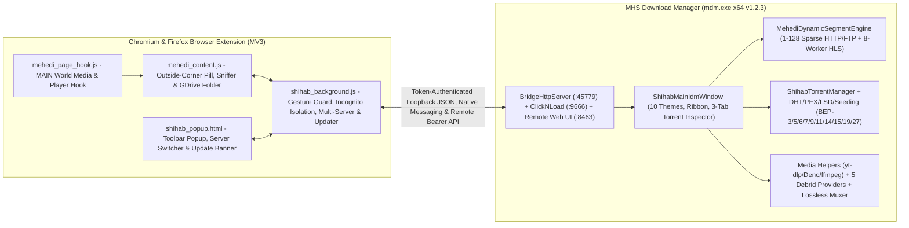

<div align="center">


# MHS Download Manager

**High-Speed Windows x64 Download Accelerator, Full BitTorrent P2P Client, Smart Browser Stream Sniffer & Lossless Media Muxer**

Developed by **[Mehedi Hasan Shihab](https://sshihabb007.github.io/)** (`@sshihabb007`)

[](https://github.com/sshihabb007/MHS-DOWNLOAD-MANAGER/releases)
[](https://github.com/sshihabb007/MHS-DOWNLOAD-MANAGER/releases)
[](https://github.com/sshihabb007/MHS-DOWNLOAD-MANAGER/actions/workflows/build.yml)
[-06B6D4?style=for-the-badge&logo=windows&logoColor=white)](https://github.com/sshihabb007/MHS-DOWNLOAD-MANAGER/releases)
[](#build-from-source)
[](LICENSE)

<br />

[-v1.2.3-0D74E7?style=for-the-badge&logo=windows11&logoColor=white)](https://github.com/sshihabb007/MHS-DOWNLOAD-MANAGER/releases/latest/download/MHS-Download-Manager-Setup-1.2.3-x64.exe)
[-v1.2.3-1E293B?style=for-the-badge&logo=windows&logoColor=white)](https://github.com/sshihabb007/MHS-DOWNLOAD-MANAGER/releases/latest/download/MHS-Download-Manager-Portable-1.2.3-x64.exe)
[](https://github.com/sshihabb007/MHS-DOWNLOAD-MANAGER/releases/latest/download/MHS-Browser-Extension-1.2.3.zip)

[**⬇ Download Setup Installer**](#download-installer) · [**🌐 Add Browser Extension**](#extension-setup) · [**🔄 Auto-Updater**](#auto-updater) · [**✨ Key Features**](#key-features) · [**📜 Release History**](#release-history) · [**⌨️ CLI & MCP**](#cli-reference) · [**👨‍💻 Developer**](#developer)

</div>

---

<a id="download-installer"></a>
## ⬇️ Download MHS Download Manager `v1.2.3` (Windows x64)

> [!TIP]
> ### ⭐ Recommended: Official Windows x64 Setup Installer (`v1.2.3`)
>
> 👉 **[Download `MHS-Download-Manager-Setup-1.2.3-x64.exe` (Latest Official Setup Installer)](https://github.com/sshihabb007/MHS-DOWNLOAD-MANAGER/releases/latest/download/MHS-Download-Manager-Setup-1.2.3-x64.exe)**
>
> - **All-in-One Program Files Setup:** Installs cleanly into `C:\Program Files (x86)\MHS Download Manager` (requests Windows UAC Administrator permission on install) with `mdm.exe`, dedicated `Uninstall.exe`, Desktop & Start Menu shortcuts, `magnet:` & `.torrent` file associations, 14+ browser Native Messaging host, and keeps the ready-to-load **`<InstallDir>\extension`** folder automatically refreshed atomically in place on every upgrade.
> - **Built-in SHA-256 Auto-Updater & SLSA Provenance:** Checks GitHub Releases automatically (`REST API` + rate-limit-free `GitHub Web` fallback), verifies `SHA256SUMS.txt` under an active file lock, and upgrades silently in place with one click. See [docs/CODE_SIGNING_AND_TRUST.md](docs/CODE_SIGNING_AND_TRUST.md) for Authenticode signing and SmartScreen trust setup.

### Official Release Downloads

| Release Asset | Recommended For | Direct Download (`v1.2.3`) | What It Contains |
| :--- | :--- | :--- | :--- |
| **`MHS-Download-Manager-Setup-1.2.3-x64.exe`** | **⭐ Standard Desktop Install *(Recommended)*** | [**⬇ Download Setup `.exe`**](https://github.com/sshihabb007/MHS-DOWNLOAD-MANAGER/releases/latest/download/MHS-Download-Manager-Setup-1.2.3-x64.exe) | Graphical Windows x64 Setup Wizard (`mdm.exe` + unpacked `<InstallDir>\extension\` + dedicated `Uninstall.exe` + shortcuts + `magnet:`/`.torrent` associations + Native Messaging). |
| **`MHS-Download-Manager-Portable-1.2.3-x64.exe`** | **Portable / USB / Zero-Install** | [**⬇ Download Portable `.exe`**](https://github.com/sshihabb007/MHS-DOWNLOAD-MANAGER/releases/latest/download/MHS-Download-Manager-Portable-1.2.3-x64.exe) | Standalone single-file `mdm.exe` executable. Run from any folder with no installer required (auto-registers per-user Native Messaging for browser integration). |
| **`MHS-Browser-Extension-1.2.3.zip`** | **Portable Users Only** | [**⬇ Download Extension `.zip`**](https://github.com/sshihabb007/MHS-DOWNLOAD-MANAGER/releases/latest/download/MHS-Browser-Extension-1.2.3.zip) | Unpacked Manifest V3 browser extension archive *(Setup `.exe` users already get `<InstallDir>\extension` automatically)*. |
| **`SHA256SUMS.txt`** | **Cryptographic Integrity Check** | [**⬇ View `SHA256SUMS.txt`**](https://github.com/sshihabb007/MHS-DOWNLOAD-MANAGER/releases/latest/download/SHA256SUMS.txt) | Official SHA-256 checksums used both for manual verification and the built-in fail-closed Auto-Updater. |

### Option A — Install Using the Setup `.exe` *(Recommended)*

1. Download **[`MHS-Download-Manager-Setup-1.2.3-x64.exe`](https://github.com/sshihabb007/MHS-DOWNLOAD-MANAGER/releases/latest/download/MHS-Download-Manager-Setup-1.2.3-x64.exe)** from [**GitHub Releases**](https://github.com/sshihabb007/MHS-DOWNLOAD-MANAGER/releases).
2. Double-click `MHS-Download-Manager-Setup-1.2.3-x64.exe` to launch the Setup Wizard.
3. Choose your installation folder (or keep the standard Windows Program Files directory):
   ```text
   C:\Program Files (x86)\MHS Download Manager
   ```
   *(Standard Windows Program Files directory; Setup automatically prompts for Administrator permission via UAC when installing)*
4. Click **Install Now**. Setup installs the desktop app and places the ready-to-load browser extension right inside `<InstallDir>\extension\`:
   ```text
   <InstallDir>\
   ├── mdm.exe                      # MHS Download Manager 1.2.3 (x64 Desktop App)
   ├── extension\                   # Unpacked Browser Extension (load this folder in your browser!)
   │   ├── manifest.json            # Chromium MV3 manifest (Chrome / Brave / Edge / Opera / Vivaldi)
   │   ├── manifest.firefox.json    # Firefox / Gecko MV3 manifest
   │   ├── mehedi_content.js        # Floating 'Download Video' pill, sniffer & update toast
   │   ├── mehedi_page_hook.js      # Media & player stream detector
   │   ├── shihab_background.js     # Gesture guard, Incognito isolation, Relay & multi-server sync
   │   ├── shihab_popup.html        # Toolbar popup UI, server switcher & update banner
   │   └── images\                  # 3D Extension & developer icons
   ├── Uninstall.exe                # Dedicated Clean Windows Uninstaller
   ├── README.md                    # Documentation
   └── LICENSE                      # MIT License
   ```
5. Keep **"Launch MHS Download Manager 1.2.3 now"** checked and click **Finish**.

### Option B — Run the Portable `.exe` *(Zero Installation)*

1. Download **[`MHS-Download-Manager-Portable-1.2.3-x64.exe`](https://github.com/sshihabb007/MHS-DOWNLOAD-MANAGER/releases/latest/download/MHS-Download-Manager-Portable-1.2.3-x64.exe)** into any permanent folder (e.g., `D:\Tools\MHS-Download-Manager\`).
2. *(Optional — for browser integration)* Download **[`MHS-Browser-Extension-1.2.3.zip`](https://github.com/sshihabb007/MHS-DOWNLOAD-MANAGER/releases/latest/download/MHS-Browser-Extension-1.2.3.zip)** and extract it into `D:\Tools\MHS-Download-Manager\extension\`.
3. Run `MHS-Download-Manager-Portable-1.2.3-x64.exe`. It starts the local loopback bridge automatically on `http://127.0.0.1:45779`.

---

<a id="extension-setup"></a>
## 🌐 How to Add the Browser Extension to Your Browser

> [!IMPORTANT]
> **No Web Store account required — takes 30 seconds!**
> When you install via **`MHS-Download-Manager-Setup-1.2.3-x64.exe`**, the unpacked extension is already saved at:
> ```text
> C:\Program Files (x86)\MHS Download Manager\extension
> ```
> *(Or `<YourCustomInstallDir>\extension` if you picked a custom folder, or the extracted folder if using the Portable ZIP.)*

### Step 1 — Open or Copy Your Extension Folder Path

Use **any** of these 3 instant methods:

1. **Setup Finish Screen:** On the last page of the Setup Wizard, `<InstallDir>\extension` is **automatically copied to your clipboard** (plus **Copy Path** and **Open Folder** buttons).
2. **Inside MHS Download Manager:** Click **Help → Open Browser Extension Folder...** (or click the **`☰` Menu → Open Browser Extension Folder...**).
3. **Windows Start Menu:** Open **Start → MHS Download Manager → MHS Browser Extension Folder**.

### Step 2 — Add to Your Browser

| Browser | Extensions Page URL | Where to Enable Developer Mode | Action |
| :--- | :--- | :--- | :--- |
| **Google Chrome** | `chrome://extensions` | Top-right toggle (**Developer mode**) | Click **Load unpacked** → select `extension` folder |
| **Brave Browser** | `brave://extensions` | Top-right toggle (**Developer mode**) | Click **Load unpacked** → select `extension` folder |
| **Microsoft Edge** | `edge://extensions` | Left sidebar (**Developer mode**) | Click **Load unpacked** → select `extension` folder |
| **Opera / Opera GX** | `opera://extensions` | Top-right toggle (**Developer mode**) | Click **Load unpacked** → select `extension` folder |
| **Vivaldi / Chromium** | `vivaldi://extensions` | Top-right toggle (**Developer mode**) | Click **Load unpacked** → select `extension` folder |
| **Mozilla Firefox** | `about:debugging#/runtime/this-firefox` | Built-in Temporary Add-on loader | Rename/copy `manifest.firefox.json` → `manifest.json` in a copy of `extension`, then click **Load Temporary Add-on...** → select `manifest.json` |

#### Detailed Chromium Steps (Chrome, Brave, Edge, Opera, Vivaldi)

1. Open your browser's Extensions page (`chrome://extensions`, `brave://extensions`, `edge://extensions`, or `opera://extensions`).
2. Switch **Developer mode** **ON**.
3. Click **Load unpacked**.
4. Paste `C:\Program Files (x86)\MHS Download Manager\extension` into the folder dialog address bar, press **Enter**, verify you are inside the **`extension`** folder (containing `manifest.json`), and click **Select Folder**.
5. Click the puzzle-piece **Extensions** icon in your browser toolbar and **Pin** **MHS Download Manager Integration Module**.
6. Click the pinned **MHS** icon — when `mdm.exe` is running, the status dot turns green and shows **`Connected · mdm.exe v1.2.3`**.

> [!TIP]
> **Important Extension Tips:**
> - **Keep `<InstallDir>\extension` on disk:** Chromium browsers load unpacked extensions directly from that folder.
> - **After Auto-Updating to a Newer Version:** Setup automatically updates `<InstallDir>\extension` in place. Simply visit `chrome://extensions` (or `brave://extensions` / `edge://extensions`) and click **Reload (`↻`)** on the MHS Download Manager card to pick up the newest extension features immediately.
> - **Private / Incognito Windows:** Enable *"Allow in Incognito"* / *"Allow in Private"* on the extension card if you want private-window download capture — MHS isolates Incognito cookies (`inc:` vs `std:` cookie stores) and never leaks private items to disk or LAN Remote UI unless you opt in.

---

<a id="auto-updater"></a>
## 🔄 Automatic Updates & Verification

MHS Download Manager includes a built-in, fail-closed **GitHub Releases Auto-Updater**:
- **Automatic & Manual Checks:** Checks on startup (`5s` after launch), every `6 hours`, on network reconnect, via **Help → Check for Updates (`Ctrl+U`)**, or via CLI (`mdm.exe --cli check-update` / `mdm.exe --cli update`).
- **Rate-Limit Resilient:** Queries `api.github.com/repos/sshihabb007/MHS-DOWNLOAD-MANAGER/releases/latest` first and automatically falls back to `https://github.com/sshihabb007/MHS-DOWNLOAD-MANAGER/releases/latest` + `SHA256SUMS.txt` if unauthenticated GitHub REST API limits (`403`/`429`) are hit.
- **Fail-Closed Cryptographic Verification:** Downloads `SHA256SUMS.txt`, streams the release asset to a `.download` staging file, enforces constant-time SHA-256 verification and anti-downgrade protection, and deletes any tampered/mismatched file immediately.
- **One-Click Upgrade & Restart:**
  - **Installed Setup Mode:** Launches the verified `MHS-Download-Manager-Setup-*-x64.exe` silently (`--shihab-update-mode`), waits for the old process PID to exit, refreshes `mdm.exe`, `<InstallDir>\extension\`, `Uninstall.exe`, shortcuts, icon cache, and relaunches the new version automatically.
  - **Portable Mode:** Atomically swaps `mdm.exe` (backing up to `.old`, cleaned on next boot), refreshes a sibling `extension\` folder from `MHS-Browser-Extension-*.zip` if present, and relaunches.

---

## Overview

**MHS Download Manager (`mdm.exe` v1.2.3)** is a clean-room, open-source Windows x64 download accelerator, BitTorrent P2P client, and Manifest V3 Chromium & Firefox browser extension suite crafted in pure C# and vanilla JavaScript by **Mehedi Hasan Shihab**.

Engineered for maximum throughput and zero bloat, the desktop application, BitTorrent engine, lossless media muxer, and graphical Windows Setup Wizard compile directly with the built-in Windows `.NET Framework 4.8` compiler (`csc.exe`) — requiring **zero external NuGet packages, zero third-party DLLs, and no mandatory external runtime installation**.

---

<a id="key-features"></a>
## ✨ Key Features

| Capability | Details |
| :--- | :--- |
| **🧲 Full BitTorrent P2P & Magnet Engine** | Pure-C# BitTorrent stack supporting `BEP-3` peer wire, `BEP-5` Kademlia UDP DHT (trackerless magnets), `BEP-6` Fast extension, `BEP-7` IPv6 `peers6`, `BEP-9`/`BEP-10` parallel magnet metadata, `BEP-11` `ut_pex`, `BEP-12` tracker tiers, `BEP-14` LSD, `BEP-15` UDP trackers, single & multi-file `BEP-19` WebSeeds, strict `BEP-27` private-torrent isolation, `BEP-53` `so=` file selection, real TCP seeding with share-ratio/time caps, hash-verified resume & corrupt-piece auto-repair, merged IP blocklists, **3-Tab Torrent Inspector (`Files`/Recheck, `Peers`, `Trackers`, live pieces bitmap)**, no-outer-folder toggle, and OS `magnet:`/`.torrent` registration. |
| **⚡ 1–128 Sparse Dynamic Segment Engine & Parallel HLS** | Pre-allocated NTFS sparse `.mhs.part` zero-copy storage (`FSCTL_SET_SPARSE`), `4096`-byte page-aligned halving, TTFB stall preemption, slow-connection shedding, RFC 9110 `ETag` + `64`-byte resume overlap verification with clean auto-restart, **8-worker parallel HLS downloader**, RFC 5987/2047/`%XX` `Content-Disposition` decoding, own-UA `403`/`412` bot-check fallback, HTML-instead-of-file guard, multi-segment `FTP`/`FTPS`, and `CRC32`/`MD5`/`SHA-1`/`SHA-256`/`SHA-512` verification. |
| **🎬 Media Suite, Managed Deno & 5 Debrid Providers** | Managed `yt-dlp`, `ffmpeg`, `gallery-dl`, and **Deno JS runtime** (`--js-runtimes` + `bgutil` PO-Token support) inside Windows Job Objects; user `yt-dlp` config toggle; rich codec/FPS/HDR format labels (`1080p MP4 · AV1 · 60 fps · HDR10`), `"Most compatible (H.264 + AAC)"`, `--embed-chapters`, `--concurrent-fragments`, **Live Stream "Stop & Save MP4"**; **5 Debrid providers** (**Real-Debrid**, **AllDebrid** with torrent/magnet cloud unlock, **Premiumize**, **TorBox**, **Mega-Debrid**); Google Drive single-file, Docs & **shared-folder video** resolution. |
| **🌐 14-Browser Extension, Multi-Server Pairing & Click'n'Load 2** | Native Messaging across Chromium & Firefox browsers, outside-corner `Download Video` pill (compact mode, wildcard exclusions, **Hide in Fullscreen** toggle), strict **Incognito cookie-store isolation**, **Multi-Server Remote Pairing & Switcher**, dynamic context-menu sync, and opt-in **Click'n'Load 2 local server (`127.0.0.1:9666`)** with pure-C# AES-128-CBC decryption, DNS-rebinding `403` guard, SSRF filter, and rate limiting. |
| **🎨 10 Built-In Themes, Speed Switcher & Archive Tools** | **10 built-in themes** (`Obsidian Dark`, `Midnight Nord`, `Emerald Matrix`, `Solarized Dark`, `Classic Light`, `Luna XP`, `Aero Glass`, `Adwaita`, `Breeze`, `High Contrast`) + custom `.toml` themes with WCAG contrast guard; **live `MBps ↔ Mbps` Speed Unit Switcher** on the Download Progress dialog + **Default Speed Unit** preference in Settings; `90%–200%` UI scale; **Deferred Rename** while downloading; **Drag finished files OUT** of the list; **Global Show/Hide Hotkey**; **Batch "Downloads Complete" coalescing + Snooze (`30m`/`1h`/`8h`/Restart)**; duplicate overwrite prompt; **DPAPI Saved Archive Passwords (MRU auto-try)**, split-volume & AES ZIP `7z` fallback, and **HatchZip** in-place extraction. |
| **🛡️ Privacy, Network Kill-Switch & DPAPI Vault** | Encrypted DNS (`DoH` Cloudflare/Google/Quad9/AdGuard/NextDNS/Custom) + `PlainDNS`, authenticated Manual HTTP / `SOCKS5` / `PAC` local relay, strict **VPN / Network Adapter Kill-Switch** with `netwatch` auto-resume, Windows `DPAPI` secret vault (`Forget All Sign-Ins`), `Keep private downloads` (stripped secrets) toggle, and Mark-of-the-Web (`Zone.Identifier`). |
| **📱 LAN Remote QR Web UI, Full CLI & 16-Tool MCP Server** | Mobile-responsive LAN Remote Web UI (`:8463`) with QR `#pair=` auto-pairing, `.torrent` upload, `/api/speedlimit`, and strict private-download filtering; out-of-process `--crash-monitor` freeze watchdog; `--headless` daemon; full `--cli` (`add`, `start-queue`/`stop-queue`, `install-deno`, filters, custom headers, `--deferred-rename`); and **16-tool `--mcp` JSON-RPC 2.0 server**. |

---

<a id="architecture"></a>
## 🏗️ System Architecture



### Repository Layout

```text
MHS-DOWNLOAD-MANAGER/
├── .github/workflows/
│   └── build.yml                           # Automated CI build, smoke test & GitHub Release publisher
├── assets/
│   ├── mdm.ico / mdm.png / author_shihab.jpg
├── docs/
│   └── CODE_SIGNING_AND_TRUST.md           # Authenticode signing, SmartScreen & AV trust setup guide
├── extension/                              # Manifest V3 Browser Extension (Chromium + Firefox, v1.2.3)
│   ├── manifest.json                       # Chromium MV3 manifest (v1.2.3)
│   ├── manifest.firefox.json               # Firefox / Gecko MV3 manifest (v1.2.3)
│   ├── mehedi_page_hook.js                 # MSE/XHR/fetch & EME DRM stream hook
│   ├── mehedi_content.js                   # Floating Video pill, fullscreen hide, GDrive folder & toast
│   ├── shihab_background.js                # Gesture guard, Incognito storeId isolation, multi-server & update check
│   ├── shihab_popup.html / css / mehedi_popup.js # Popup UI, remote pairing & update banner
│   ├── shihab_captured.html / mehedi_captured.js
│   └── images/                             # 3D icons & developer portrait
├── src/
│   ├── MehediProgramEntry.cs               # Entry point, CLI/MCP/Headless/Watchdog router
│   ├── Bridge/                             # Loopback HTTP bridge (:45779), relay, Automation API & Native Host
│   ├── Core/                               # Zero-dependency JSON serializer & core codecs
│   ├── Engine/                             # 1-128 sparse HTTP/FTP, 8-worker HLS, scheduler & YouTube InnerTube
│   ├── Models/                             # Configuration, queues, transfer state & download models
│   ├── Muxer/                              # Zero-dependency ISO-BMFF & EBML/Matroska muxer
│   ├── Network/                            # Local HTTP/SOCKS5/PAC/PlainDNS/DoH/VPN-bound relay
│   ├── Process/                            # Windows Job Object isolated child-process runner
│   ├── Qr/                                 # ISO/IEC 18004 QR code encoder
│   ├── Security/                           # Windows DPAPI credential & secret vault
│   ├── Shared/                             # URL/SSRF, archive, path & GitHub origin safety checks
│   ├── Storage/                            # Atomic config/downloads state store & formatting helpers
│   ├── Subsystems/                         # BitTorrent + DHT/Seeding, Click'n'Load 2, 5 Debrid, Media/Deno, Remote, RSS, 10 Themes & 16-Tool MCP
│   ├── UI/                                 # DWM chrome, 11-button ribbon, 3-tab Torrent Inspector, Options & dialogs
│   ├── Updater/                            # Resilient GitHub REST + Web fallback auto-updater & TopMost dialog
│   └── installer/
│       └── ShihabSetupWizard.cs            # Windows x64 Setup Wizard, Silent Updater, Associations & Uninstaller
├── build.ps1                               # Zero-dependency PowerShell build script
├── CHANGELOG.md                            # Complete reverse-chronological changelog (v1.2.3 -> v1.0.0)
├── LICENSE                                 # MIT License
└── README.md                               # Project documentation
```

---

<a id="build-from-source"></a>
## 🛠️ Building from Source

No Visual Studio workload, NuGet restore, or external SDK is required — any standard **Windows 10 / 11** machine includes `.NET Framework 4.8` (`csc.exe`):

```powershell
# Clone the repository
git clone https://github.com/sshihabb007/MHS-DOWNLOAD-MANAGER.git
cd MHS-DOWNLOAD-MANAGER

# Compile both bin\mdm.exe and bin\MHS-Download-Manager-Setup-1.2.3-x64.exe
powershell -NoProfile -ExecutionPolicy Bypass -File .\build.ps1
```

Build outputs generated in `bin\`:
- `bin\mdm.exe` — Standalone x64 desktop application (also published as `MHS-Download-Manager-Portable-1.2.3-x64.exe` in Releases)
- `bin\MHS-Download-Manager-Setup-1.2.3-x64.exe` — Official Windows x64 Setup Installer (embeds `mdm.exe`, dedicated `Uninstall.exe`, `extension\`, `README.md`, and `LICENSE` in Win32 `.rsrc`)

---

<a id="cli-reference"></a>
## ⌨️ Command-Line & MCP Reference

### Application CLI (`mdm.exe`)

```text
mdm.exe /d <URL> [/p <LocalPath>] [/f <LocalFileName>] [/n] [/q] [/a] [/s] [/fromhost]
```

| Command / Flag | Description |
| :--- | :--- |
| `/d <URL>` `[ /p /f /n /q /a /s /fromhost ]` | IDM-compatible download switches (`/fromhost` launches stealth without raising main window) |
| `--cli add <URL>` `[-o Dir] [-f Name] [-c Cat] [-q Queue] [-l KB/s] [--no-start] [--private] [--checksum <alg:hex>] [--cookie <v>] [--referer <v>] [--user-agent <v>] [--deferred-rename <Name>]` | Add or start an HTTP/HTTPS/FTP/FTPS/Magnet/`.torrent` transfer with full options |
| `--cli status [--json] [--id <id>] [--status <st>] [--search <q>] [--category <c>] [--queue <q>] [--limit <n>]` | Live bridge status table or filtered JSON (including `freeSpaceBytes`) |
| `--cli start-queue [Name]` / `stop-queue [Name]` | Start or stop a specific queue (default: `Main Download Queue`) |
| `--cli pause <id>` / `resume <id>` / `remove <id>` | Control transfers by full or 6+ char short ID |
| `--cli video-get <URL> [-q compatible] [--audio-only]` / `gallery-get <URL>` | Download video/playlists/galleries via managed `yt-dlp` / Deno / `ffmpeg` / `gallery-dl` |
| `--cli install-ytdlp` / `install-ffmpeg` / `install-deno` / `install-gallery-dl` | Install or update managed helper tools |
| `--cli torrent-info <target>` / `torrent-get <target>` / `torrent-create <src>` | Inspect, download, or create `.torrent` files and magnets |
| `--cli check-update [--json]` / `update [--verify-only]` | Check, cryptographically verify (`SHA256SUMS.txt`), and apply GitHub Releases |
| `--cli pair [--json]` / `api [on\|off]` | Generate LAN Remote pairing code + QR, or toggle Local Automation API |
| `--mcp` | Run the Model Context Protocol (`MCP`) JSON-RPC 2.0 stdio server (**16 tools**) |
| `--headless` | Run background download engine, bridge, Click'n'Load 2, Remote UI & scheduler without GUI |
| `--forget-sign-ins` | Purge all DPAPI-encrypted credentials, tokens, archive passwords & paired devices |

### Setup Installer CLI (`MHS-Download-Manager-Setup-1.2.3-x64.exe`)

```text
MHS-Download-Manager-Setup-1.2.3-x64.exe [--shihab-silent] [--shihab-install-dir <Path>] [--shihab-no-registry]
```

| Flag | Description |
| :--- | :--- |
| `--shihab-silent` / `/S` | Perform an unattended silent installation (or silent uninstallation with `Uninstall.exe`) |
| `--shihab-install-dir <Path>` | Install into a custom target directory |
| `--shihab-no-registry` | Extract files without writing `HKLM`/`HKCU` shortcuts, Startup, associations, or Uninstall registry keys |
| `--shihab-update-mode` | In-place silent upgrade mode used automatically by `ShihabAutoUpdater` |
| `--shihab-uninstall` | Run uninstallation routine (invoked automatically by `<InstallDir>\Uninstall.exe`) |

---

<a id="release-history"></a>
## 📜 Release History (Reverse Chronological — Latest First)

Browse all full release downloads on [**GitHub Releases (`v1.2.3` → `v1.0.0`)**](https://github.com/sshihabb007/MHS-DOWNLOAD-MANAGER/releases) or read the detailed version log in [**CHANGELOG.md**](CHANGELOG.md).

| Version | Date | Key Highlights | Key Bug Fixes & Hardening |
| :--- | :--- | :--- | :--- |
| [**`v1.2.3`** *(Latest)*](https://github.com/sshihabb007/MHS-DOWNLOAD-MANAGER/releases/tag/v1.2.3) | 2026-11-28 | **Installer PE trust & AV false-positive remediation** (Win32 `.rsrc` `RT_RCDATA` packaging dropping `.text` entropy `7.96 → 5.59`, dedicated `279 KB` `Uninstall.exe`, `asInvoker` + UAC worker, native `IShellLinkW` / `MoveFileExW` / `QueryFullProcessImageNameW`, Authenticode CI signing & SLSA provenance), **full security audit hardening**, and **major browser + desktop CPU/RAM/I/O optimization** with zero feature compromise | Closed installer/updater junction LPE & pre-UAC TOCTOU races, extension SSRF/cookie exfiltration/spoofing (closed Shadow DOM, `isTrusted`, tab-scoped relay), bridge auth bypass, local proxy auth, archive traversal, `yt-dlp.conf` hijack, and Remote Control/Click'n'Load CSRF; replaced 450 ms relay polling with `/shihab/relay-jobs?wait=20000` long-polling, removed 900 ms intervals & global style `MutationObserver`s, downscaled `author_shihab.jpg` (`158 KB → 2.1 KB`), switched crash heartbeat to 4 KB `MemoryMappedFile` (eliminating ~72k disk ops/day), added 64 KB SOH buffers, full-duplex async `NetworkStream` proxy relay, BitTorrent buffer/handle pooling, fixed 24 `HICON` leaks, gated idle WinForms timers, and reduced `RegexOptions.Compiled` `69 → 1` |
| [**`v1.2.2`**](https://github.com/sshihabb007/MHS-DOWNLOAD-MANAGER/releases/tag/v1.2.2) | 2026-11-26 | **Universal multi-site video stream detection** across X/Twitter, LinkedIn, Vimeo, TikTok, and sandboxed HLS/MP4 streaming embeds (`match_about_blank`), in-page `#EXTM3U` + MSE `blob:` lineage tracking, **flicker-free in-place dropdown menu** with single-click download stability, and disguised HLS desktop routing | Fixed `shihabHVal` `ReferenceError` crashing `webRequest.onHeadersReceived` on all `206 Partial Content` streams; eliminated 15 Hz dropdown DOM destruction & fast-blinking/dropped clicks on LinkedIn Video.js feeds via persistent Shadow DOM menu, diffed in-place row patching, 80 ms click-protection lock, and filtered `MutationObserver`; added `li:<assetId>` grouping, bidirectional X `tw:`/`twv:` unification, MV3 `chrome.storage.session` stream persistence, WebM `SeekHead`/DRM & MP4 `tkhd` rotation fixes, and 120 ms coalesced background stream pushes |
| [**`v1.2.1`**](https://github.com/sshihabb007/MHS-DOWNLOAD-MANAGER/releases/tag/v1.2.1) | 2026-11-24 | Instant single-click switching across all 11 multiline **Options** tabs (`Sites Logins`, `Dial Up / VPN`, `Sounds`, `Debrid & Vault`, `Updates & P2P` + bottom row), crisp tab hover tracking, and clean Options section banners | Fixed `ShihabDarkTabControl.OnMouseDown` re-hit-testing post-swap `GetTabRect()` coordinates on multiline tabs (which bounced first-row clicks back to the second row); added 64-bit-safe `WM_SETCURSOR` hand cursor without ambient cursor leakage into `TabPage` controls; fixed unescaped `&` in Options section banners (`UseMnemonic = false`) and tightened **Options → Downloads** layout to remove unnecessary 100%-DPI scrollbar |
| [**`v1.2.0`**](https://github.com/sshihabb007/MHS-DOWNLOAD-MANAGER/releases/tag/v1.2.0) | 2026-11-23 | **Live inline `MBps ↔ Mbps` Speed Unit Switcher** on Download Progress dialog, persistent **Default Speed Unit** setting in **Options → General** reflected app-wide (grid, footer, tray, drop target, LAN Remote UI), and standard **`C:\Program Files (x86)\MHS Download Manager`** Windows Setup installer with dedicated UAC/DPI/long-path manifests, Medium-IL de-elevation (`CreateProcessWithTokenW` + Explorer COM fallback), `HKLM` 64/32-bit Native Messaging & associations, and automatic migration from legacy AppData installs | Fixed Options → General vertical clipping & checkbox overlap with `AutoScroll` + DPI-safe layout; hardened elevated deferred self-uninstall & `shihab_native_host_launcher.cmd` against path metacharacters (`)`, `&`, `%`); hardened cross-IL mutex checks (`MutexRights.Synchronize`) and Auto-Updater UAC cancel (`1223`) / read-only folder guards; cleaned up stale `HKCU\...\Run` on unchecked Startup and `ToolTip`/`Timer` disposal in `Dispose(bool)` |
| [**`v1.1.1`**](https://github.com/sshihabb007/MHS-DOWNLOAD-MANAGER/releases/tag/v1.1.1) | 2026-11-20 | Seamless zero-freeze in-place auto-updates, non-inheritable local bridge/listener handles, instant non-blocking **`Download Video`** dropdown, atomic in-place extension updates, and PID-aware crash watchdog | Fixed 3-generation Win32 TCP socket-handle inheritance zombieing `:45779` after silent auto-update; fixed unbounded Native Messaging hangs & mid-update respawns via `UseShellExecute = true` + installer mutex; fixed popup hanging on `"Checking mdm.exe bridge..."` and frozen `"Download Video"` click; fixed `shihabScopedCacheKey` header lookup miss, cold-SW paired-server race, duplicate context-menu IDs, Incognito batch cookies, `magnet:?` passive click, and PID-blind false watchdog crash logs |
| [**`v1.1.0`**](https://github.com/sshihabb007/MHS-DOWNLOAD-MANAGER/releases/tag/v1.1.0) | 2026-11-20 | Complete **BitTorrent P2P overhaul** (`BEP-3/5 DHT/6/7/9/11 PEX/14 LSD/15/19/27/53`, real TCP seeding, 3-tab Torrent Inspector, OS `magnet:`/`.torrent` associations), **Click'n'Load 2 (`:9666`)**, **8-worker parallel HLS**, **Managed Deno JS runtime** + codec/FPS/HDR + H.264/AAC compatible + chapters + Live Stream Stop & Save MP4, **5 Debrid providers** (+TorBox, +Mega-Debrid, +Google Drive shared folders), **10 built-in themes** + custom `.toml` WCAG guard + 200% scale, **Deferred Rename**, **Drag-out**, **Global Hotkey**, **Batch Complete + Snooze**, **DPAPI Saved Archive Passwords** + HatchZip, **Multi-Server Extension Pairing** + Incognito isolation, **16-tool MCP**, and expanded CLI | Fixed `bridge.token` desync, `PlainDNS` mismatch, Manual HTTP proxy auth & VPN leaks inside relay/FTP/InnerTube, LAN Remote QR `#pair=` & privacy filter, `View → Theme` dead presets, Options `Forget All Sign-Ins` in-memory wipe, RFC 5987/2047/`%XX` filenames, own-UA `403` fallback, HTML-instead-of-file guard, resume overlap auto-restart, archive split-volume & AES ZIP fallback, scheduler active-days/wake re-arm, Automation API `403` gate, and Click'n'Load TCP RST drain |
| [**`v1.0.7`**](https://github.com/sshihabb007/MHS-DOWNLOAD-MANAGER/releases/tag/v1.0.7) | 2026-11-13 | Rock-solid dark/light DWM custom chrome (`ShihabChromeForm`), restore-size stability, automatic Desktop & Taskbar shortcut icon cache refresh (`SHChangeNotify` + `ie4uinit.exe -show`) during updates, and explicit `WM_SETICON` small/big HICON assignment | Fixed classic caption `[□] [×] [?]` & thick light outer border regression on `WM_NCACTIVATE` / restore; fixed `+14×14px` restore size growth; fixed stale Desktop/Taskbar icon cache across upgrades; fixed shared `Icon` disposal bug |
| [**`v1.0.6`**](https://github.com/sshihabb007/MHS-DOWNLOAD-MANAGER/releases/tag/v1.0.6) | 2026-11-13 | Modular C# architecture refactor (`src/<Domain>/`), resilient GitHub REST + Web fallback auto-updater with `/shihab/open-updater`, browser update banner (online & offline) + dismissible page toast, top-right **Background Minimize** button, Firefox `webRequestBlocking`, and new glowing 3D blue-magenta icon across app, setup & extension | Fixed dual Brave/Chrome/Edge native Save-As + MDM popups via `onDeterminingFilename` early cancel & erase; fixed silent `403` rate-limit updater failures; fixed offline popup hiding update banner; enabled `--headless` update cache population; tightened update & archive origin checks |
| [**`v1.0.5`**](https://github.com/sshihabb007/MHS-DOWNLOAD-MANAGER/releases/tag/v1.0.5) | 2026-11-12 | Top Menu Bar (`Tasks`, `File`, `Downloads`, `View`, `Help`, `Registration`), full-width 11-button GDI+ gradient ribbon toolbar, upgraded `Sun..Sat` Queue Scheduler, `Tell a Friend` QR dialog, and `Registration` dialog | Fixed compact/wide toolbar responsive layout (`955px–1320px+`), Queue Scheduler ordering & periodic sync reliability, and secondary dialog theme synchronization |
| [**`v1.0.4`**](https://github.com/sshihabb007/MHS-DOWNLOAD-MANAGER/releases/tag/v1.0.4) | 2026-11-12 | GitHub Releases Auto-Updater + `SHA256SUMS.txt` verification, `1–128` NTFS sparse `.mhs.part` segment engine, BitTorrent & magnet P2P engine, `yt-dlp`/`ffmpeg`/`gallery-dl` helpers, Debrid unlockers, `DoH`/`SOCKS5`/`PAC`/VPN Kill-Switch, `DPAPI` vault, LAN QR Web UI (`:8463`), 14-browser Native Messaging (Chromium + Firefox), 5 themes + 28 languages, crash watchdog, and 15-tool MCP server | Eliminated resume corruption via RFC 9110 `ETag` + `64`-byte overlap verification; reduced worker tail stalls via TTFB preemption & slow-connection shedding; added `X-MHS-Bridge-Token` local RPC authentication |
| [**`v1.0.3`**](https://github.com/sshihabb007/MHS-DOWNLOAD-MANAGER/releases/tag/v1.0.3) | 2026-11-02 | Dark Transfers Dashboard (`TRANSFERS` sidebar, `Local Storage` card, instant filter search, 8-column grid, 4-pill footer), outside-corner `Download Video` pill + `MHS STREAM SNIFFER` dropdown, circular developer portrait About dialog, and streamlined Setup + Portable + ExtZip releases | Removed duplicate Setup installer aliases from release staging; fixed container probe labeling and dark scrollbar/DPI alignment |
| [**`v1.0.2`**](https://github.com/sshihabb007/MHS-DOWNLOAD-MANAGER/releases/tag/v1.0.2) | 2026-10-31 | `chrome.storage.session` browser-startup & trusted user-gesture guard (`event.isTrusted === true` + per-tab/child-popup propagation + download ID seeding), plus sequential FIFO capture modal queue with `4s` duplicate-burst suppression | Eliminated spurious startup/restore/background download popups in Brave, Chrome, and Edge; prevented stacked capture dialogs and false clipboard popups at launch |
| [**`v1.0.1`**](https://github.com/sshihabb007/MHS-DOWNLOAD-MANAGER/releases/tag/v1.0.1) | 2026-10-31 | Outside top-right corner `Download Video` bar (`62%–96%` glass styling), cross-instance DOM singleton coordination, `<InstallDir>\extension` Setup verifier with Finish **Copy Path**/**Open Folder**, and GitHub Actions CI release pipeline | Eliminated overlapping floating video bars across reloads/SPAs; kept player controls uncovered on full-height Shorts/Reels/TikTok players; refreshed stale unpacked extension files during upgrades |
| [**`v1.0.0`**](https://github.com/sshihabb007/MHS-DOWNLOAD-MANAGER/releases/tag/v1.0.0) | 2026-10-30 | Initial open-source release: Obsidian-Violet dark UI, InnerTube HD/4K (`2160p`) & parallel burst-sliced companion audio, zero-dependency lossless MP4/WebM/MKV muxer, `1–32` segment engine, Browser Fetch Relay, Queues, Site Grabber, Native Messaging, and x64 Setup Wizard | Fixed YouTube HTTP `403` companion audio throttling (`KeepAlive` burst slicing & InnerTube client resolution); isolated per-video captions/metadata on multi-video feeds |

---

<a id="developer"></a>
## 👨‍💻 About the Developer

**MHS Download Manager** is designed, engineered, and maintained by **Mehedi Hasan Shihab** — a **Software & Systems Engineer** focused on building fast, clean, user-centric desktop tools and full-stack web applications.

| Field | Details |
| :--- | :--- |
| **Developer** | **Mehedi Hasan Shihab** *(Software & Systems Engineer)* |
| **GitHub** | [@sshihabb007](https://github.com/sshihabb007) |
| **Portfolio** | [https://sshihabb007.github.io/](https://sshihabb007.github.io/) |
| **LinkedIn** | [linkedin.com/in/mehedi-hasan-shihab](https://www.linkedin.com/in/mehedi-hasan-shihab) |
| **Email** | [sshihabb007@gmail.com](mailto:sshihabb007@gmail.com) |
| **Project Repository** | [github.com/sshihabb007/MHS-DOWNLOAD-MANAGER](https://github.com/sshihabb007/MHS-DOWNLOAD-MANAGER) |

<div align="center">

[](https://sshihabb007.github.io/)
[](https://github.com/sshihabb007)
[](https://www.linkedin.com/in/mehedi-hasan-shihab)
[](mailto:sshihabb007@gmail.com)

</div>

---

## 📄 License & Responsible Use

Released under the **[MIT License](LICENSE)** — Copyright © 2026 **Mehedi Hasan Shihab (`sshihabb007`)**.

> **Note:** MHS Download Manager accelerates standard HTTP/HTTPS file transfers, BitTorrent swarms, and non-DRM media streams that your browser already has permission to access. Encrypted DRM / EME streams (`Widevine`, `PlayReady`, `FairPlay`, `SAMPLE-AES`) are strictly respected and never bypassed.
